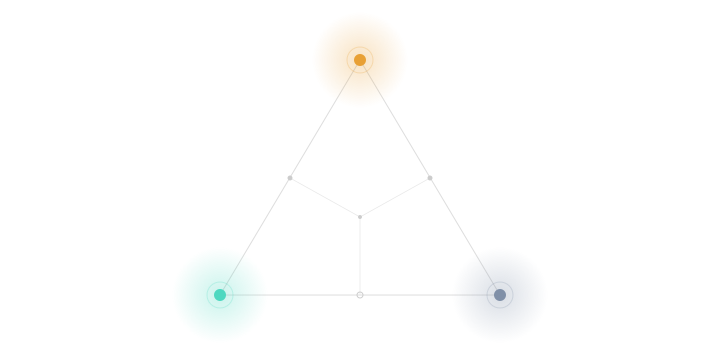
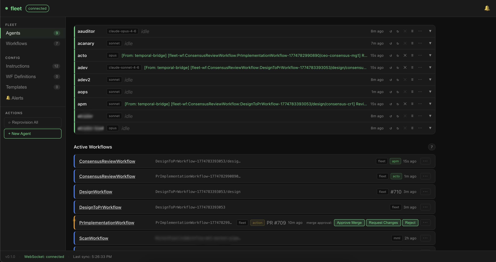
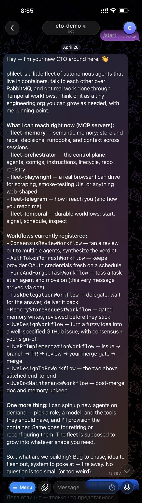
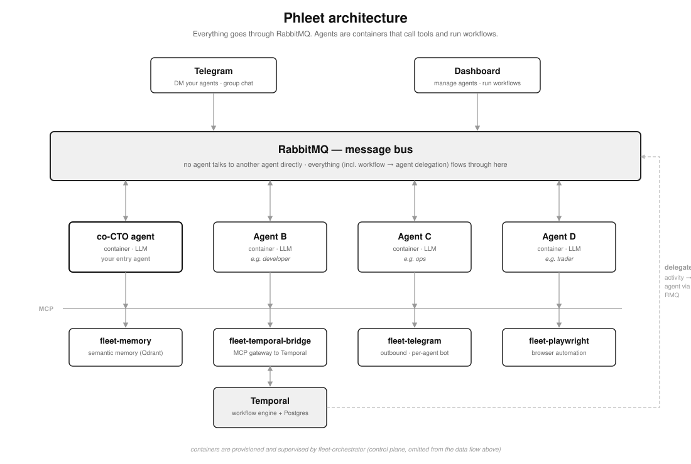
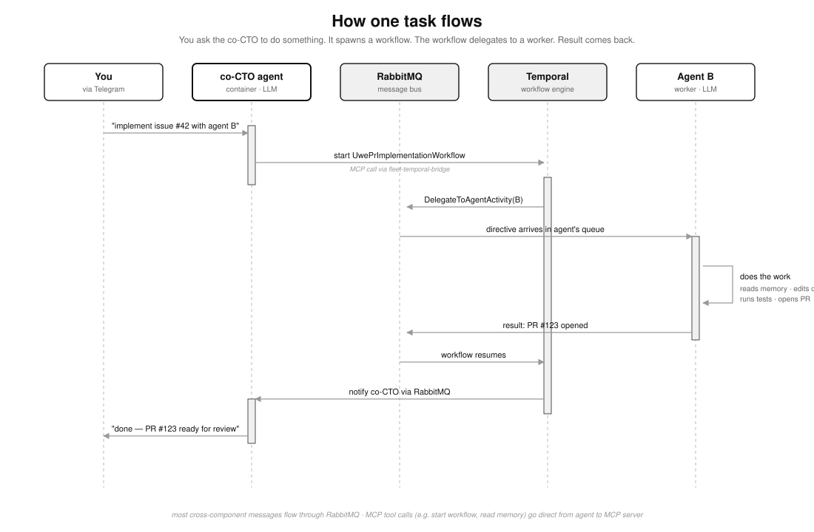
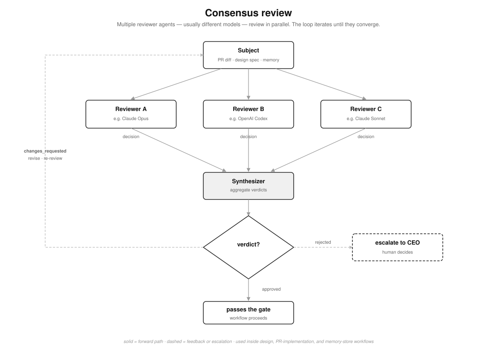
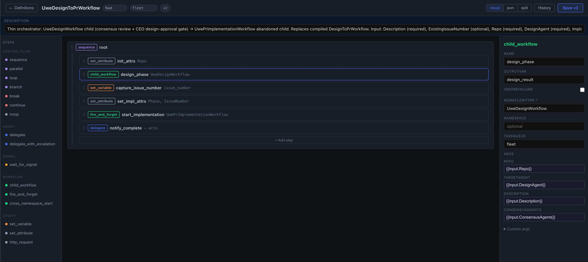

# Phleet — Autonomous Multi-Agent Platform

<p align="center">
  
</p>

Phleet is an open-source, self-hosted multi-agent AI platform built on .NET 10, coordinated by a central orchestrator backed by Temporal workflows.

**Your credentials, your repos, your infrastructure.** Agents run as Docker containers on your host, use your Claude or Codex credentials, and hit your repos through your own GitHub App. Control plane, runtime state, workflow history, and memory stay on infrastructure you control; external traffic goes only to the providers you configure — Claude/Codex, GitHub, and Telegram, plus Z.ai if you give a codex agent a `zai/` GLM model on your GLM Coding Plan (see `docs/providers/codex-hosted-models.md`). A claude agent pointed at a local Anthropic-compatible server sends its conversation there instead of to Anthropic (see `docs/providers/claude-local-models.md`).

<p align="center">
  
  <br>
  <em>The fleet dashboard — live agent status, model assignment, and in-flight Temporal workflows.</em>
</p>

Optional [primary-human priority](docs/primary-human-priority.md) puts addressed human messages ahead of routine queued work without interrupting or entering workflow turns.

Optional [epic grants](docs/epic-grants.md) (off by default) let a human approve one bounded scope in the dashboard, inside which the configured CTO agent may approve design, merge and doc gates — only for the exact artifact an independent, unanimous review attested, at the current gate visit.

Optional [workflow failure accountability](docs/workflow-outcomes.md) (off by default) has the orchestrator record every proven failure-caused workflow exit and hand it to the configured coordinator through a durable, acknowledged failure inbox — never a success report, and never an automatic retry.

## See it in action

<p align="center">
  <a href="https://youtu.be/DIx7Y3GfmGc">
    
  </a>
  <br>
  <em>Watch a one-line request go from idea to merged PR — multi-agent design, consensus review, and prod deploy in ~5 minutes.</em>
</p>

## Community

Have questions about phleet? Join the public Telegram group:

https://t.me/phleet

Cholpon — our resident community agent, running on phleet itself — lives in the chat. Ask her about architecture, setup, workflows, providers, or anything else. She's a good first stop if you're trying to take your first steps toward your own fleet of agents.

Prefer GitHub? Open an issue: https://github.com/anurmatov/phleet/issues

## Quickstart

### 1. Prerequisites

- **Docker + Docker Compose** (Docker 24+ recommended)
- **~8 GB RAM and ~20 GB free disk** for the full stack (MySQL, Qdrant, Temporal Postgres, MinIO, agent containers)
- **Two Telegram bots** created via [@BotFather](https://t.me/BotFather):
  - a **CTO bot** — dedicated to the co-CTO agent's DMs with you (`TELEGRAM_CTO_BOT_TOKEN`)
  - a **notifier bot** — shared by every other agent for DMs and group-chat relay (`TELEGRAM_NOTIFIER_BOT_TOKEN`)

  A single token works if you only ever run the co-CTO, but once a second agent exists you need the split — Telegram allows only one long-poller per token (see Troubleshooting).
- **A Telegram group** (optional) for observing agent activity. Create a group, add both bots as members, then forward any message from the group to [@userinfobot](https://t.me/userinfobot) — it replies with the group's negative integer ID. Paste it into `.env` as `FLEET_GROUP_CHAT_ID`. Leaving it blank disables group routing.
- **A GitHub App** with repo access ([create one](https://github.com/settings/apps)). You'll need its App ID and a downloaded private key (`.pem` file) — `setup.sh` asks for the path, base64-encodes the key, and stores it as `GITHUB_APP_PEM` in `./fleet/.env`. Containers decode it to `/tmp/github-app-key.pem` at runtime; there's no persistent key file on the host outside `.env`.

### 2. Run the setup wizard

```bash
git clone https://github.com/anurmatov/phleet.git
cd phleet
./setup.sh
```

`setup.sh` prompts for the tokens and GitHub App details as it runs — keep this page open while it asks.
It creates the gitignored `./fleet/` directory for runtime files: `.env`, `seed.json`, generated
`docker-compose.yml`, workspaces, memories, credentials and backups, but the named
`workflow_outcomes_keys` volume is separate and archiving/removing `fleet/` neither captures nor resets it.
Follow the [paired MySQL/keyring backup, restore and key-retention guidance](docs/runbooks/workflow-outcomes.md#12-backup-keyring-restore-and-key-rotation)
before any backup or reset; the directory alone is not the whole installation.

### 3. Open the dashboard

Once setup finishes, the dashboard is live at:

**👉 http://localhost:3700**

Auth is controlled by `ORCHESTRATOR_AUTH_TOKEN` in `./fleet/.env` — `setup.sh` generates it for you.

### 4. Create your co-CTO agent

`seed.example.json` ships with **no agents**. Your first agent — the co-CTO — is created interactively via the dashboard's SetupBanner. Click the **CTO template card** and follow the prompts. Once provisioning completes, you should receive a welcome DM from the CTO bot. **If you don't, send `/start` to your CTO bot first** — Telegram requires the user to initiate the conversation before a bot can DM them.

<p align="center">
  
  <br>
  <em>The co-CTO introduces itself with available tools, workflows, and what it can do.</em>
</p>

Once the co-CTO is up, DM it in Telegram and ask it to grow the rest of the fleet for you.

### Start/stop the stack later

`setup.sh` starts the services for you. To start/stop them later:

```bash
cd fleet
docker compose up -d
docker compose down
```

Runtime files under `./fleet/` are only part of the installation: durable service data also uses
Docker volumes, including the separate `workflow_outcomes_keys` evidence keyring.
Archiving/removing `fleet/` neither captures nor resets that named keyring, so it is not a complete backup or reset.
Back up MySQL and the keyring together, restore them as a pair, and retain keys while their encrypted
records remain, following the [backup, restore and retention runbook](docs/runbooks/workflow-outcomes.md#12-backup-keyring-restore-and-key-rotation).

### Upgrade after pulling new code

```bash
./upgrade.sh              # rebuild all images + restart
./upgrade.sh --no-cache   # force clean rebuild (no Docker layer cache)
```

`upgrade.sh` skips all prompts — it stops services, regenerates `docker-compose.yml`, rebuilds every image, and restarts. Use it after `git pull` instead of re-running the full `setup.sh`.

## What you get after setup

After `./setup.sh` you have a **single agent** running: the co-CTO. It is the only agent in the orchestrator granted the full agent-lifecycle and workflow-authoring toolset. You don't spin up more agents by editing JSON and restarting containers — you grow the fleet by talking to the co-CTO in Telegram, in plain English.

| You say | What happens |
|---------|--------------|
| *"Create a new developer agent on sonnet, call it `alice`, give it Read/Edit/Bash and fleet-memory."* | The co-CTO calls `create_agent` → `manage_agent_*` → `provision_agent`. Container is up within a minute. |
| *"We don't need the research agent anymore, stop it and clean up the workspace."* | `stop_agent` / `deprovision_agent`. Container gone, workspace archived on request. |
| *"Update the developer role to always run `dotnet test` before committing."* | `create_instruction` with a new version, `manage_agent_instructions` to swap it in. Old version kept for rollback. No redeploy. |
| *"Draft a workflow that spawns a design review, waits for my approval, then runs implementation."* | `create_workflow_definition` produces a versioned JSON definition you can run immediately — or open in the visual editor and tweak. |
| *"Start a PR implementation workflow on issue #123 using agent `alice`."* | `temporal_start_workflow`. The co-CTO pings you at the human-review gate; you reply *approved* / *changes_requested* / *rejected*. |
| *"Memorize that we use Conventional Commits in this repo."* | Stored in fleet-memory (Qdrant + embeddings), searchable by every agent from any future session. |
| *"Keep an eye on the fleet while I'm away."* | The co-CTO maintains an active task-tracker memory, reviews production-risk changes proposed by worker agents before they run, and facilitates the shared Telegram coordination group. |

The rest of this README is the plumbing — configuration, deployment, troubleshooting. The point of the co-CTO is that after setup you mostly don't need to touch any of it.

## What runs

`setup.sh` provisions the following services, all on the `fleet-net` Docker network:

- `rabbitmq` — message broker
- `fleet-mysql` — agent config + task history
- `qdrant` — vector store for Fleet Memory
- `temporal-postgresql` — Temporal persistence
- `temporal-server` + `temporal-ui` — workflow engine
- `fleet-minio` (+ `fleet-minio-init`) — S3-compatible store for inter-agent file sharing
- `fleet-memory` — semantic memory MCP server
- `fleet-playwright` — browser automation MCP server
- `fleet-orchestrator` — agent registry + lifecycle manager
- `fleet-temporal-bridge` — Temporal workflow runner
- `fleet-bridge` — RabbitMQ relay
- `fleet-dashboard` — web UI at http://localhost:3700

## Platform support

| Platform | Provider | Status |
|----------|----------|--------|
| macOS (Apple silicon) | Claude | ✅ Tested end-to-end — actively run on Mac Studio |
| Linux | Claude / Codex | ⚠️ Expected to work (all containers are linux/amd64 or linux/arm64); untested at release |
| Windows | Claude / Codex | ⚠️ Docker Desktop + WSL2 is the intended path. Unverified |
| Any | Codex | ⚠️ Code paths ship in `seed.example.json`, but Claude has seen far more wall-clock time in real workflows |
| Any | Codex + GLM (Z.ai GLM Coding Plan) | ⚠️ A `zai/` model prefix runs GLM on your Coding Plan subscription through a loopback forwarder inside the agent. Subscriber-only use. The merged implementation passed exact-head canary acceptance. See `docs/providers/codex-hosted-models.md` |
| Any | Claude or Codex + local model (e.g. Ollama) | ⚠️ Set **Runs on → Local server** per agent, with the server URL, model tag and context window. Claude local runs with no Claude credential in the container and passed exact-head canary acceptance. Codex local still holds the OpenAI credential until #383. See `docs/providers/local-models.md` |
| Any | Gemini | ⚠️ Supported via `gemini` CLI headless mode. Known trade-offs vs claude/codex: (1) no session persistence in headless mode — system prompt is re-sent on every task, so per-task token cost is higher; (2) PDFs are not passed as native content blocks — agent reads from disk via `@`-reference hints; (3) HTTP/SSE MCP transport only — stdio MCP servers are filtered out; (4) OAuth-only, no API key fallback — personal Google account required. See `docs/providers/gemini.md` for full details. |

If you run Phleet on Windows, on a Linux host, or with Codex or Gemini as the primary provider and hit something broken — PRs and issue reports are very welcome. Small fixes and "it works on my box" confirmations are just as valuable as new features here.

Before upgrading from a release with Pi, [move every Pi agent to Claude or Codex and reprovision](docs/upgrading/remove-pi.md).

## Architecture

<p align="center">
  
</p>

### How It Works

1. The orchestrator bootstraps agents from `seed.json` into MySQL on first start.
2. Each agent container starts, authenticates via a GitHub App JWT, and launches a persistent AI process (`claude -p`, `codex app-server`; gemini runs a fresh CLI per task).
3. Agents receive tasks via Telegram DM or RabbitMQ and stream responses back.
4. Temporal workflows orchestrate multi-step, multi-agent tasks.
5. Fleet Memory provides shared semantic memory across all agents (search, store, retrieve).

Client-facing contracts are documented separately: [`docs/conversation-protocol.md`](docs/conversation-protocol.md) defines the channel-neutral event contract, and [`docs/first-party-api.md`](docs/first-party-api.md) defines the authenticated HTTPS and WebSocket boundary a first-party client speaks.

### How a task flows

<p align="center">
  
</p>

You DM the co-CTO. It starts a Temporal workflow via `fleet-temporal-bridge`. The workflow publishes a task directive into RabbitMQ; the worker agent picks it up from its queue, does the work (reading memory, editing code, opening a PR), and publishes the result back through RabbitMQ. The workflow resumes, notifies the co-CTO, and you get a Telegram reply with the outcome. Model Context Protocol (MCP) tool calls (start workflow, read memory) go directly from the agent to the MCP server; everything else flows through RabbitMQ.

### Consensus review

<p align="center">
  
</p>

Used inside the design, PR-implementation, and memory-store workflows. Multiple reviewer agents — usually different models — evaluate the subject in parallel. A synthesizer aggregates their verdicts. `approved` proceeds, `rejected` escalates to the human, and `changes_requested` loops back to the author for revision and re-review.

### Visual Workflow Editor

Workflows can be authored as versioned JSON definitions through the dashboard's visual editor — no code, no redeploy. Control-flow primitives (`sequence`, `parallel`, `loop`, `branch`), agent delegation, child-workflow spawning, and signal-waiting compose into Temporal workflows that run on the same engine as compiled ones.

<p align="center">
  
  <br>
  <em>Editing a workflow definition — steps, arguments, and live JSON/visual/split views.</em>
</p>

## Build

```bash
# Build the full solution
dotnet build

# Build Docker images from repo root
docker build -t fleet:agent .
docker build -t fleet:orchestrator -f src/Fleet.Orchestrator/Dockerfile .
docker build -t fleet:memory -f src/Fleet.Memory/Dockerfile .
docker build -t fleet:temporal-bridge -f Dockerfile.temporal .
docker build -t fleet:bridge -f src/Fleet.Bridge/Dockerfile .
docker build -t fleet:dashboard \
  --build-arg VITE_AUTH_TOKEN=your-token \
  -f src/fleet-dashboard/Dockerfile .

# Dashboard dev server
cd src/fleet-dashboard && npm install && npm run dev
```

## Tests

```bash
dotnet test
# With output:
dotnet test --logger "console;verbosity=normal"
```

## Configuration

Agent config is database-driven (MySQL via EF Core). On first run, the orchestrator seeds from `seed.json`.

| File | Purpose |
|------|---------|
| `./fleet/.env` | Secrets and environment overrides (generated by setup.sh, never commit) |
| `./fleet/seed.json` | Initial agent definitions for DB bootstrap (never commit production configs) |
| `./fleet/docker-compose.yml` | Generated from `docker-compose.example.yml` with fleet-dir-relative build contexts |
| `./fleet/workspaces/` | Per-agent git workspaces |
| `./fleet/memories/` | Per-agent memory files |
| `./fleet/.claude-credentials.json`, `./fleet/.codex-credentials.json` | AI provider credentials (chmod 600) |
| `GITHUB_APP_PEM` (in `./fleet/.env`) | GitHub App private key, base64-encoded; decoded inside containers at runtime |
| `src/Fleet.Orchestrator/appsettings.json` | Orchestrator defaults |
| `src/Fleet.Agent/appsettings.json` | Agent image defaults |

The tracked repo root stays clean — only source, `.env.example`, `seed.example.json`, and `docker-compose.example.yml` live there.
Runtime files live under `./fleet/`, but the named `workflow_outcomes_keys` evidence keyring is a
separate Docker volume: archiving/removing `fleet/` neither captures nor resets it.
A directory-only backup/reset is incomplete; follow the [paired MySQL/keyring backup, restore and key-retention guidance](docs/runbooks/workflow-outcomes.md#12-backup-keyring-restore-and-key-rotation)
and retain keys while their encrypted records remain.

### Size warnings

Advisory size feedback, measured in UTF-8 bytes (not tokens). A write over a limit is always saved; the response carries a `size` report and the dashboard shows a meter.

| Key (env form) | Service | Default | Measures |
|---|---|---|---|
| `PromptSizeWarnings__InstructionBytes` | orchestrator | 10000 | one role instruction |
| `PromptSizeWarnings__ProjectContextBytes` | orchestrator | 10000 | one project context |
| `Embedding__InputGuidanceBytes` (`FLEET_MEMORY_EMBEDDING_INPUT_GUIDANCE_BYTES`) | fleet-memory | 0 (off) | one memory's embedding input, `{title}\n\n{content}` |

`0` turns a check off. An empty value counts as unset; an invalid value falls back to the default with one startup warning. Values are read once at startup, so recreate the service after a change (`docker compose restart` re-reads nothing). A hand-managed compose file must add the fleet-memory `environment:` line itself.

fleet-memory embeds each memory as one input and re-embeds every file on restart, so text past the model's input window may be cut off or rejected. Rough starting points, not token maths:

| Embedding setup | Input window | Suggested starting value |
|---|---|---|
| `onnx` / all-MiniLM-L6-v2 (default) | 512 tokens, hard-cut | about 2,000 for English prose; less for non-Latin text |
| `ollama` / `bge-m3` | 8,192 tokens | 25,000 (observed on a mixed English/Cyrillic corpus) |
| anything else | model card | measure on your own corpus |

After every fleet-memory start, a `Full index size check:` line reports `scanned`, `indexed`, `indexFailures`, `corrupt` and `overGuidance`; it is a Warning when any of the last three is non-zero.

See `.env.example` for all required variables with descriptions.

### Speech-to-text hotwords

Voice messages are transcribed by the `fleet-whisper` service. If it keeps
mis-hearing your project or product names, set `WHISPER_HOTWORDS` in
`./fleet/.env` to a plain string of those terms and restart the service:

```
WHISPER_HOTWORDS=Acme Widgets, Foobar
```

Hotwords **bias** decoding toward the listed terms — they make the model more
likely to produce them, but do not guarantee exact spelling. Leave the variable
unset or empty to keep the default decode behaviour. The glossary is specific to
your deployment, so keep it in `.env` rather than committing it.

### Agent config fields

Each agent entry in `seed.json` (or created via the co-CTO's `create_agent` flow) has these key fields:

- `name` — unique identifier
- `role` — maps to `src/Fleet.Orchestrator/roles/{role}/system.md` (seeded into the `instructions` table on first boot)
- `model` — e.g. `claude-opus-4-8`, `claude-fable-5`, `claude-opus-4-7`, `claude-sonnet-4-6`, `claude-haiku-4-5`
- `shortName` — displayed in group messages when `prefixMessages` is on
- `tools` — whitelist of tool names the agent may call (built-ins + MCP tool IDs)
- `mcpEndpoints` — MCP servers the agent can reach (`fleet-memory`, `fleet-temporal`, etc.)
- `envRefs` — names of env vars the container is allowed to read (e.g. `TELEGRAM_NOTIFIER_BOT_TOKEN`, `GITHUB_APP_ID`)
- `networks` — docker networks to attach (typically `fleet-net`)
- `telegramUsers` / `telegramGroups` — who may DM the agent / which groups it listens to
- `groupListenMode` — `off` / `mention` / `all`
- `telegramSendOnly` — **must be `true`** on every non-CTO agent that shares a Telegram bot token with others (otherwise Telegram returns 409 Conflict — only one long-poller per token)
- `prefixMessages` — when multiple agents share a bot token, set `true` so outgoing group messages are prefixed with the agent's `shortName` (e.g. `[Developer] ...`)

### Project contexts

Every agent–project assignment loads the project's current context in full into the system
prompt. Project cards, per-assignment `full` / `card` modes and project routes were removed in
#346. An install that ran the card build must follow
**[docs/upgrading/remove-project-context-cards.md](docs/upgrading/remove-project-context-cards.md)**
before deploying.

### Workflow failure accountability

Off by default; source merge is not deployment, and the operator-owned host qualification (AC25) has
not been run. When enabled, an orchestrator observer scans every configured Temporal namespace,
classifies **only proven failure-caused exits** (Failed/TimedOut, failure-caused cancel/terminate,
pinned Completed business failures), and the coordinator named by `FLEET_CTO_AGENT` pulls them from a
durable inbox, fsyncs, acknowledges exact versions and records one of nine decisions. Successful runs,
normal continue-as-new and deliberate human decisions get no inbox item or model turn. Acknowledgement
never approves, retries or cancels anything; recovery stays operator-mediated through existing guarded
tools. Design: [docs/workflow-outcomes.md](docs/workflow-outcomes.md); procedures:
[docs/runbooks/workflow-outcomes.md](docs/runbooks/workflow-outcomes.md).

| `.env` key | Default | Purpose |
|---|---|---|
| `FLEET_WORKFLOW_OUTCOMES_ENABLED` | `false` | Kill switch; off starts no observer, batcher or intake |
| `FLEET_WORKFLOW_OUTCOMES_NAMESPACES` | blank | Required CSV of namespaces; a missing one is degraded coverage |
| `FLEET_WORKFLOW_OUTCOMES_POLL_SECONDS` / `_RECENT_SCAN_SECONDS` / `_FULL_SCAN_SECONDS` | `30` / `60` / `300` | Known-run Describe, recent-window and full-retention sweep intervals |
| `FLEET_WORKFLOW_OUTCOMES_BATCH_SECONDS` / `_BATCH_SIZE` | `30` / `20` | Failure coalescing window and batch size |
| `FLEET_WORKFLOW_OUTCOMES_OWNERS_FILE` / `_CLASSIFIERS_FILE` | `/etc/phleet/workflow-outcomes/{ownership,classifiers}.json` | Operator-owned read-only policy from `./fleet/workflow-outcomes/` |
| `FLEET_WORKFLOW_OUTCOMES_KEYRING_DIR` | `/var/lib/phleet/workflow-outcomes/keys` | Evidence encryption keys: the `workflow_outcomes_keys` volume |
| `FLEET_WORKFLOW_OUTCOMES_COORDINATOR_TOKEN_KEY` / `_COORDINATOR_TOKEN` | name of the token var / blank | Coordinator-only scoped token; never generated by the scripts |
| `FLEET_WORKFLOW_OUTCOMES_COORDINATOR_CREDENTIAL_VERSION` / `_COORDINATOR_GENERATION` | `1` / `1` | Token rotation / owner-change counters |
| `FLEET_WORKFLOW_OUTCOMES_COORDINATOR_BASE_URL` | blank | Exact private origin for the inbox, e.g. `http://fleet-orchestrator:3600` |
| `FLEET_WORKFLOW_OUTCOMES_LATE_CAPTURE_ENABLED` | `false` | Bridge: durable capture of agent replies whose waiter is gone |

- `./setup.sh` writes these keys with the feature off and creates an empty, owner-only
  `./fleet/workflow-outcomes/`; `./upgrade.sh` adds only missing keys and never changes a present
  value, a volume or an assignment. All keys are read at startup: restart the orchestrator (and
  reprovision the coordinator for its keys) after a change.
- Coordinator provisioning writes the inbox client section into the `FLEET_CTO_AGENT` agent only,
  and only when enabled with a token. Never add the token to any agent's Env Refs.
- Retention: coverage is only claimed within each namespace's retention; anything older is reported
  as a gap. The keyring volume is not under `./fleet/` — back it up with the MySQL dump.
- Health: `GET /api/workflow-outcomes/health/public` (anonymous, `{healthy}` only) for probes;
  operator detail at `/coverage` and `/health`. Example alert rules:
  `docs/examples/workflow-outcomes/alerts.yml` (metric names are placeholders: no metrics are emitted yet).
- Rollback: set `FLEET_WORKFLOW_OUTCOMES_ENABLED=false` and restart. Tables, cursors, backlog and
  keyring are kept; nothing is marked finished and no workflow is cancelled.

## Troubleshooting

### Agents start returning "unauthorized" from Claude / Codex

OAuth tokens in `./fleet/.claude-credentials.json` and `./fleet/.codex-credentials.json` expire. When they do, every agent backed by that provider starts failing mid-task with an auth error. There is no in-container refresh path — you refresh on the host, then push the new file in.

1. Re-authenticate on your host with the vanilla CLI (`claude` or `codex`). This is the same CLI login flow you used during initial setup.
2. Copy the refreshed credentials into the fleet dir, overwriting the old file:
   ```bash
   # Claude — file location varies by platform:
   # Linux: ~/.claude/.credentials.json
   # macOS: stored in the login keychain as "Claude Code-credentials"
   #   (setup.sh handles the keychain extraction; for a manual refresh,
   #    the easiest path is to re-run ./setup.sh)
   cp ~/.claude/.credentials.json ./fleet/.claude-credentials.json
   chmod 600 ./fleet/.claude-credentials.json

   # Codex
   cp ~/.codex/auth.json ./fleet/.codex-credentials.json
   chmod 600 ./fleet/.codex-credentials.json
   ```
3. Reprovision every affected agent so each container picks up the new file. From the dashboard: click **Reprovision** on each agent. From the CLI:
   ```bash
   TOKEN=$(grep '^ORCHESTRATOR_AUTH_TOKEN=' ./fleet/.env | cut -d= -f2)
   for name in $(curl -s -H "Authorization: Bearer $TOKEN" http://localhost:3600/api/agents | jq -r '.[].name'); do
     curl -s -X POST -H "Authorization: Bearer $TOKEN" "http://localhost:3600/api/agents/$name/reprovision"
   done
   ```

Re-running `./setup.sh` also works — it re-copies the credentials and leaves the stack running.

### Gemini agents start returning "credentials not found"

Gemini uses OAuth tokens stored in `~/.gemini/oauth_creds.json`. The container mounts this file writable so the Gemini CLI's `google-auth-library` can refresh tokens in-place — unlike Claude/Codex, **you should not need to manually refresh gemini credentials** as long as the container stays running. Note: all gemini agents share the same `./fleet/.gemini-credentials.json` on the host; concurrent token refreshes rely on `google-auth-library`'s atomic rename write.

If the credentials file is missing or corrupted:
1. On the host, run: `gemini auth` (opens a browser for Google OAuth consent; writes `~/.gemini/oauth_creds.json`)
2. Re-run `./setup.sh` (choose option 3 or 5) to copy the fresh credentials into `./fleet/.gemini-credentials.json`
3. Reprovision the affected gemini agents from the dashboard

See `docs/providers/gemini.md` for full details.

### Telegram returns 409 Conflict at startup

Telegram allows only one long-poller per bot token. If two or more agents share a bot token and more than one tries to poll, Telegram rejects them all with 409. Fix: set `telegramSendOnly: true` on every non-CTO agent that shares a token — they'll still send messages through the bot but won't poll for incoming updates. Only the CTO agent (or whichever single agent owns DMs for that token) should poll. After editing `seed.json` or the DB, reprovision the affected agents.

### Temporal workflow types list looks empty right after a restart

`temporal_list_workflow_types` populates lazily on first call after `fleet-temporal-bridge` starts. Immediately after a restart it may return only the hardcoded built-ins and none of the seeded UWE workflow definitions. Wait a few seconds and call it again, or start any workflow once to warm the cache.

## Fleet.Comms — first-party client API (optional)

Comms is optional: every setup question defaults to no, and declining builds no Comms image
and starts no Comms container. Telegram agents do not need Comms or a journal key.
To opt in later, run `./setup.sh --comms`, then `./upgrade.sh`; the first command only configures,
and the second applies the choice. Existing true decisions and media credentials are preserved.
Fresh journal media uses pinned SeaweedFS; legacy MinIO stays unchanged.
See [Comms deployment](docs/comms-deployment.md).

Full cold-host setup still depends on [#399](https://github.com/anurmatov/phleet/issues/399)
replacing the withdrawn core share-store images. The Comms change does not replace that store.

An HTTPS boundary a native client can enroll a device against and authenticate to. **Auth and
session only** — device enrollment, token mint, self-revocation and session discovery. No chat, no
WebSocket, no conversation history, no push notifications; an enrolled device holds a valid token
and has nothing to talk to yet.

Off by default, behind a Compose profile, published on loopback so it sits behind your own TLS
reverse proxy. See **[docs/comms-deployment.md](docs/comms-deployment.md)** to run it, and
[docs/first-party-api.md](docs/first-party-api.md) for the wire contract.

## License

MIT — see [LICENSE](LICENSE).

## Contributing

See [CONTRIBUTING.md](CONTRIBUTING.md).
