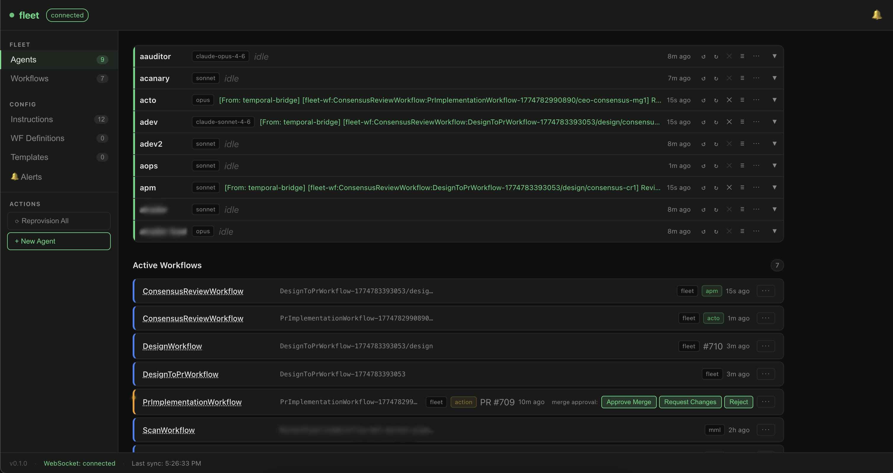
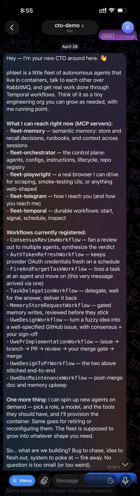
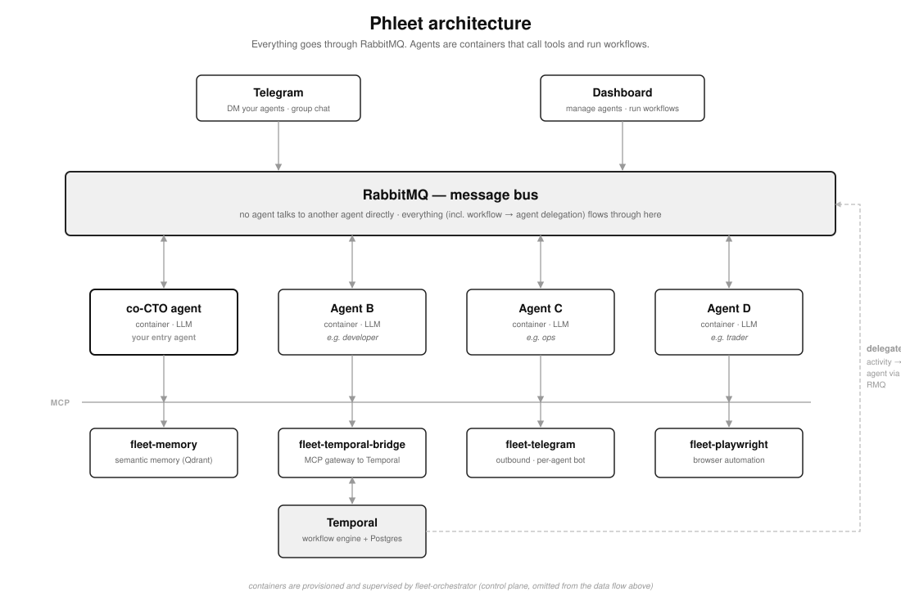

# Phleet — Autonomous Multi-Agent Platform

<p align="center">
  
</p>

Phleet is an open-source, self-hosted multi-agent AI platform built on .NET 10, coordinated by a central orchestrator backed by Temporal workflows.

**Your credentials, your repos, your infrastructure.** Agents run as Docker containers on your host, use your Claude or Codex credentials, and hit your repos through your own GitHub App. Control plane, runtime state, workflow history, and memory stay on infrastructure you control; external traffic goes only to the providers you configure — Claude/Codex, GitHub, and Telegram, plus Z.ai if you give a codex agent a `zai/` GLM model on your GLM Coding Plan (see `docs/providers/codex-hosted-models.md`). A claude agent pointed at a local Anthropic-compatible server sends its conversation there instead of to Anthropic (see `docs/providers/claude-local-models.md`).

<p align="center">
  
  <br>
  <em>The fleet dashboard — live agent status, model assignment, and in-flight Temporal workflows.</em>
</p>

Optional [primary-human priority](docs/primary-human-priority.md) puts addressed human messages ahead of routine queued work without interrupting or entering workflow turns.

Optional [epic grants](docs/epic-grants.md) (off by default) let a human approve one bounded scope in the dashboard, inside which the configured CTO agent may approve design, merge and doc gates — only for the exact artifact an independent, unanimous review attested, at the current gate visit.

## See it in action

<p align="center">
  <a href="https://youtu.be/DIx7Y3GfmGc">
    
  </a>
  <br>
  <em>Watch a one-line request go from idea to merged PR — multi-agent design, consensus review, and prod deploy in ~5 minutes.</em>
</p>

## Community

Have questions about phleet? Join the public Telegram group:

https://t.me/phleet

Cholpon — our resident community agent, running on phleet itself — lives in the chat. Ask her about architecture, setup, workflows, providers, or anything else. She's a good first stop if you're trying to take your first steps toward your own fleet of agents.

Prefer GitHub? Open an issue: https://github.com/anurmatov/phleet/issues

## Quickstart

### 1. Prerequisites

- **Docker + Docker Compose** (Docker 24+ recommended)
- **~8 GB RAM and ~20 GB free disk** for the full stack (MySQL, Qdrant, Temporal Postgres, MinIO, agent containers)
- **Two Telegram bots** created via [@BotFather](https://t.me/BotFather):
  - a **CTO bot** — dedicated to the co-CTO agent's DMs with you (`TELEGRAM_CTO_BOT_TOKEN`)
  - a **notifier bot** — shared by every other agent for DMs and group-chat relay (`TELEGRAM_NOTIFIER_BOT_TOKEN`)

  A single token works if you only ever run the co-CTO, but once a second agent exists you need the split — Telegram allows only one long-poller per token (see [Troubleshooting](docs/troubleshooting.md)).
- **A Telegram group** (optional) for observing agent activity. Create a group, add both bots as members, then forward any message from the group to [@userinfobot](https://t.me/userinfobot) — it replies with the group's negative integer ID. Paste it into `.env` as `FLEET_GROUP_CHAT_ID`. Leaving it blank disables group routing.
- **A GitHub App** with repo access ([create one](https://github.com/settings/apps)). You'll need its App ID and a downloaded private key (`.pem` file) — `setup.sh` asks for the path, base64-encodes the key, and stores it as `GITHUB_APP_PEM` in `./fleet/.env`. Containers decode it to `/tmp/github-app-key.pem` at runtime; there's no persistent key file on the host outside `.env`.

### 2. Run the setup wizard

```bash
git clone https://github.com/anurmatov/phleet.git
cd phleet
./setup.sh
```

`setup.sh` prompts for the tokens and GitHub App details as it runs — keep this page open while it asks. It creates a `./fleet/` subdirectory next to the repo and puts all runtime state there: `.env`, `seed.json`, generated `docker-compose.yml`, `workspaces/`, `memories/`, credentials, MinIO, and MySQL backups. The whole dir is gitignored — to fully reset, stop containers and `rm -rf fleet/`.

### 3. Open the dashboard

Once setup finishes, the dashboard is live at:

**👉 http://localhost:3700**

Sign-in is controlled by `ORCHESTRATOR_AUTH_TOKEN` in `./fleet/.env` — `setup.sh` generates it for
you. The dashboard asks for it once per browser and then keeps a session; the token is never built
into the page. Internal services calling the orchestrator directly need it as a bearer for writes, as
before. To check a token without changing anything, `GET /api/operator-token` with the bearer answers
`{"status":"accepted"}` or `401` (`"not_required"` when no token is configured). See
[`docs/sign-in.md`](docs/sign-in.md).
To connect the [iOS app](https://github.com/anurmatov/phleet-ios) to this dashboard, open
**Credentials → Devices → Connect a phone** and scan the setup code; see
[`docs/phone-setup-code.md`](docs/phone-setup-code.md).

### 4. Create your co-CTO agent

`seed.example.json` ships with **no agents**. Your first agent — the co-CTO — is created interactively via the dashboard's SetupBanner. Click the **CTO template card** and follow the prompts. Once provisioning completes, you should receive a welcome DM from the CTO bot. **If you don't, send `/start` to your CTO bot first** — Telegram requires the user to initiate the conversation before a bot can DM them.

<p align="center">
  
  <br>
  <em>The co-CTO introduces itself with available tools, workflows, and what it can do.</em>
</p>

Once the co-CTO is up, DM it in Telegram and ask it to grow the rest of the fleet for you.

### Start/stop the stack later

`setup.sh` starts the services for you. To start/stop them later:

```bash
cd fleet
docker compose up -d
docker compose down
```

All stateful services bind-mount their data under `./fleet/` — no named Docker volumes. Back up or wipe the whole installation by archiving or removing that single directory.

### Upgrade after pulling new code

```bash
./upgrade.sh              # rebuild all images + restart
./upgrade.sh --no-cache   # force clean rebuild (no Docker layer cache)
```

`upgrade.sh` skips all prompts — it stops services, regenerates `docker-compose.yml`, rebuilds every image, and restarts. Use it after `git pull` instead of re-running the full `setup.sh`.

Before upgrading an existing installation, check the [upgrade notes](docs/upgrading/README.md).

## What you get after setup

After `./setup.sh` you have a **single agent** running: the co-CTO. It is the only agent in the orchestrator granted the full agent-lifecycle and workflow-authoring toolset. You don't spin up more agents by editing JSON and restarting containers — you grow the fleet by talking to the co-CTO in Telegram, in plain English.

| You say | What happens |
|---------|--------------|
| *"Create a new developer agent on sonnet, call it `alice`, give it Read/Edit/Bash and fleet-memory."* | The co-CTO calls `create_agent` → `manage_agent_*` → `provision_agent`. Container is up within a minute. |
| *"We don't need the research agent anymore, stop it and clean up the workspace."* | `stop_agent` / `deprovision_agent`. Container gone, workspace archived on request. |
| *"Update the developer role to always run `dotnet test` before committing."* | `create_instruction` with a new version, `manage_agent_instructions` to swap it in. Old version kept for rollback. No redeploy. |
| *"Draft a workflow that spawns a design review, waits for my approval, then runs implementation."* | `create_workflow_definition` produces a versioned JSON definition you can run immediately — or open in the visual editor and tweak. |
| *"Start a PR implementation workflow on issue #123 using agent `alice`."* | `temporal_start_workflow`. The co-CTO pings you at the human-review gate; you reply *approved* / *changes_requested* / *rejected*. |
| *"Memorize that we use Conventional Commits in this repo."* | Stored in fleet-memory (Qdrant + embeddings), searchable by every agent from any future session. |
| *"Keep an eye on the fleet while I'm away."* | The co-CTO maintains an active task-tracker memory, reviews production-risk changes proposed by worker agents before they run, and facilitates the shared Telegram coordination group. |

The rest is plumbing — configuration, deployment, troubleshooting — and lives in the [documentation](#documentation). The point of the co-CTO is that after setup you mostly don't need to touch any of it.

## Architecture

<p align="center">
  
</p>

### How It Works

1. The orchestrator bootstraps agents from `seed.json` into MySQL on first start.
2. Each agent container starts, authenticates via a GitHub App JWT, and launches a persistent AI process (`claude -p`, `codex app-server`; gemini runs a fresh CLI per task).
3. Agents receive tasks via Telegram DM or RabbitMQ and stream responses back.
4. Temporal workflows orchestrate multi-step, multi-agent tasks.
5. Fleet Memory provides shared semantic memory across all agents (search, store, retrieve).

Client-facing contracts are documented separately: [`docs/conversation-protocol.md`](docs/conversation-protocol.md) defines the channel-neutral event contract, and [`docs/first-party-api.md`](docs/first-party-api.md) defines the authenticated HTTPS and WebSocket boundary a first-party client speaks.

## Documentation

| Topic | Where |
|---|---|
| Services, task flow, consensus review, workflow editor | [docs/architecture.md](docs/architecture.md) |
| Platforms and providers | [docs/platform-support.md](docs/platform-support.md) |
| Configuration files, size warnings, agent config fields, optional features | [docs/configuration.md](docs/configuration.md) |
| Troubleshooting | [docs/troubleshooting.md](docs/troubleshooting.md) |
| Upgrade notes for existing installations | [docs/upgrading/](docs/upgrading/README.md) |
| Building and testing from source | [docs/development.md](docs/development.md) |

## Fleet.Comms — chat with your agents (optional)

Comms is optional: every setup question defaults to no, and declining builds no Comms image
and starts no Comms container. Telegram agents do not need Comms or a journal key.
To opt in later, run `./setup.sh --comms`, then `./upgrade.sh`; the first command only configures,
and the second applies the choice. Existing true decisions and media credentials are preserved.
Fresh journal media uses pinned SeaweedFS; legacy MinIO stays unchanged.
See [Comms deployment](docs/comms-deployment.md).

Full cold-host setup still depends on [#399](https://github.com/anurmatov/phleet/issues/399)
replacing the withdrawn core share-store images. The Comms change does not replace that store.

Chat with any agent from the dashboard's Chat view and the iOS app: one thread per agent, with
history, a live stream, cancel, and a phone notification for a reply you were not watching. Chat is
on for every agent by default and can be turned off per agent. Sign-in is the orchestrator's, so the
same signed-in browser or phone is used for chat, and clients reach Comms through the dashboard's
address.

Off by default, behind a Compose profile. See **[docs/comms-deployment.md](docs/comms-deployment.md)**
to run it, and [docs/first-party-api.md](docs/first-party-api.md) for the wire contract.

## License

MIT — see [LICENSE](LICENSE).

## Contributing

See [CONTRIBUTING.md](CONTRIBUTING.md).

Exact-request, report-only human questions and answers are documented in
[human input requests](docs/human-input-requests.md). The backend/dashboard
source is separate from native-client and real-phone rollout qualification.
