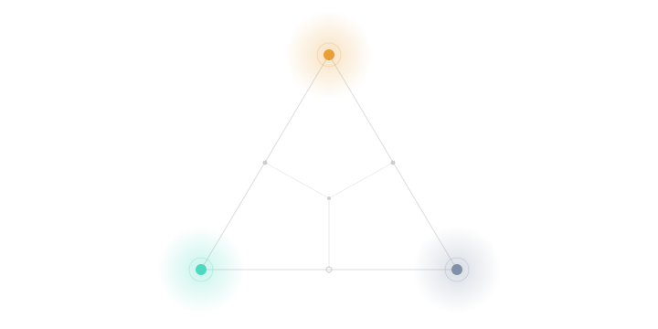
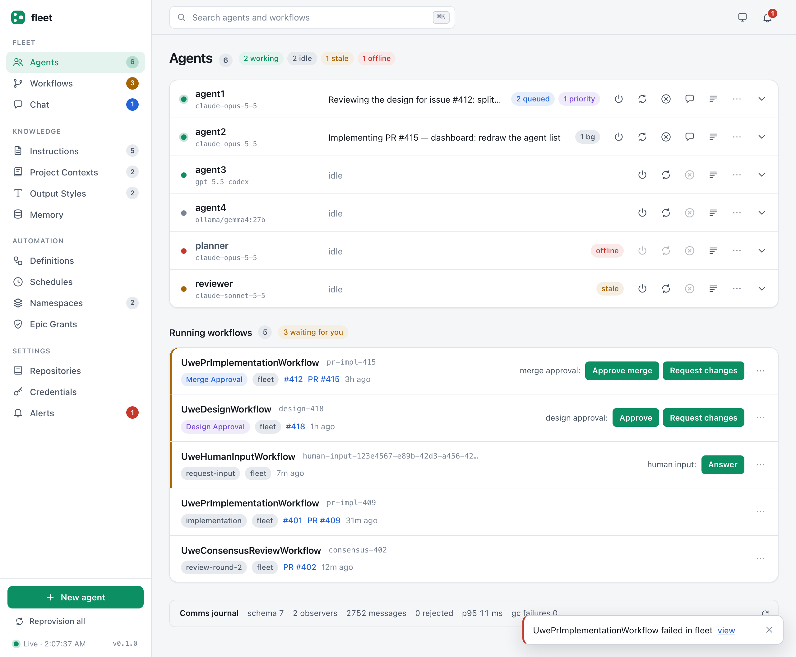

# Phleet

<p align="center">
  
</p>

**A self-hosted team of AI agents that you run by talking to one of them.**

Phleet runs Claude, Codex or Gemini agents as Docker containers on your own machine. You message one agent, the co-CTO, in Telegram. It creates the other agents, hands them work, and runs workflows that design, implement and review changes, stopping for your approval at the gates you choose.

- **Yours.** Your provider credentials, your GitHub App, your host. Runtime state, workflow history and memory stay on your machine; outbound traffic goes only to the providers you configure.
- **Reviewed.** Work passes a consensus review by several agents, usually on different models, before it reaches you.
- **Changed while running.** Agents, their instructions and workflow definitions are versioned records you change from chat or the dashboard, with no redeploy.
- **Shared memory.** Every agent can search and store a common semantic memory.

<p align="center">
  
  <br>
  <em>The dashboard: every agent and what it is doing, and the workflows waiting for you.</em>
</p>

## What you do with it

After setup one agent is running: the co-CTO. It is the only agent with the full agent-lifecycle and workflow-authoring toolset. You grow and run the fleet by talking to it in Telegram, in plain English.

| You say | What happens |
|---------|--------------|
| *"Create a new developer agent on sonnet, call it `alice`, give it Read/Edit/Bash and fleet-memory."* | The co-CTO calls `create_agent` → `manage_agent_*` → `provision_agent`. Container is up within a minute. |
| *"We don't need the research agent anymore, stop it and clean up the workspace."* | `stop_agent` / `deprovision_agent`. Container gone, workspace archived on request. |
| *"Update the developer role to always run `dotnet test` before committing."* | `create_instruction` with a new version, `manage_agent_instructions` to swap it in. Old version kept for rollback. No redeploy. |
| *"Draft a workflow that spawns a design review, waits for my approval, then runs implementation."* | `create_workflow_definition` produces a versioned JSON definition you can run immediately — or open in the visual editor and tweak. |
| *"Start a PR implementation workflow on issue #123 using agent `alice`."* | `temporal_start_workflow`. The co-CTO pings you at the human-review gate; you reply *approved* / *changes_requested* / *rejected*. |
| *"Memorize that we use Conventional Commits in this repo."* | Stored in fleet-memory (Qdrant + embeddings), searchable by every agent from any future session. |
| *"Keep an eye on the fleet while I'm away."* | The co-CTO maintains an active task-tracker memory, reviews production-risk changes proposed by worker agents before they run, and facilitates the shared Telegram coordination group. |

<p align="center">
  <a href="https://youtu.be/DIx7Y3GfmGc">
    
  </a>
  <br>
  <em>Watch a one-line request go from idea to merged PR — multi-agent design, consensus review, and prod deploy in ~5 minutes.</em>
</p>

## Quickstart

> **Known issue:** on a host that has never pulled the MinIO images, setup currently fails, because those images were withdrawn. See [#399](https://github.com/anurmatov/phleet/issues/399).

You need:

- **Docker 24+ with Compose**, about 8 GB RAM and 20 GB free disk.
- **A provider CLI signed in on the host**: `claude`, `codex` or `gemini`. Setup copies its credentials for the agents.
- **Two Telegram bots** from [@BotFather](https://t.me/BotFather): one for the co-CTO, one shared by every other agent.
- **A GitHub App** with access to your repos: its App ID and private key file.

```bash
git clone https://github.com/anurmatov/phleet.git
cd phleet
./setup.sh
```

`setup.sh` asks for the tokens, builds the images and starts the stack. All runtime state goes under `./fleet/`, which is gitignored.

1. Open the dashboard at **http://localhost:3700** and sign in with `ORCHESTRATOR_AUTH_TOKEN` from `./fleet/.env`.
2. Click the **CTO template card** and follow the prompts.
3. The co-CTO sends you a welcome DM. If it does not arrive, send `/start` to your CTO bot first.

Later, `cd fleet && docker compose up -d` (or `down`) starts and stops the stack, and `./upgrade.sh` rebuilds and restarts it after a `git pull`. Check the [upgrade notes](docs/upgrading/README.md) before upgrading an existing installation.

The full walk-through, including the optional Telegram group and how to fully reset, is in [docs/setup.md](docs/setup.md).

## How it works

<p align="center">
  
</p>

1. The orchestrator bootstraps agents from `seed.json` into MySQL on first start.
2. Each agent container starts, authenticates via a GitHub App JWT, and launches a persistent AI process (`claude -p`, `codex app-server`; gemini runs a fresh CLI per task).
3. Agents receive tasks via Telegram DM or RabbitMQ and stream responses back.
4. Temporal workflows orchestrate multi-step, multi-agent tasks.
5. Fleet Memory provides shared semantic memory across all agents (search, store, retrieve).

The services, how a task flows, consensus review and the visual workflow editor are in [docs/architecture.md](docs/architecture.md).

## Providers and platforms

| Provider | Status | Details |
|---|---|---|
| Claude | Most used | |
| Codex | Supported, less run time than Claude | |
| Gemini | Supported, with limits | [docs/providers/gemini.md](docs/providers/gemini.md) |
| A local model through Claude or Codex (for example Ollama) | Supported | [docs/providers/local-models.md](docs/providers/local-models.md) |
| GLM on a Z.ai GLM Coding Plan, through Codex | Supported, subscriber-only | [docs/providers/codex-hosted-models.md](docs/providers/codex-hosted-models.md) |

Runs on macOS (Apple silicon) and Linux. Windows through Docker Desktop and WSL2 is unverified. The full table is in [docs/platform-support.md](docs/platform-support.md).

## Optional features

Each has its own page. Chat, push notifications, secret placeholders, primary-human priority and epic grants are off until you turn them on.

- **Chat in the dashboard and the [iOS app](https://github.com/anurmatov/phleet-ios)**, one thread per agent: [docs/comms-deployment.md](docs/comms-deployment.md).
- **Phone connection and push notifications** for waiting gates, failed workflows and agents that went down: [docs/phone-setup-code.md](docs/phone-setup-code.md), [docs/push-notifications.md](docs/push-notifications.md).
- **Secret placeholders**, so a bound secret is never written into an agent container: [docs/secret-placeholders.md](docs/secret-placeholders.md). The same page covers **MCP endpoint headers**: an HTTP MCP endpoint sent headers whose values come from the agent's Env Refs, named but never typed. A bound Env Ref goes out as its placeholder and is never rendered; an unbound one is written as its `.env` value into the agent's owner-only MCP files.
- **Primary-human priority**, which puts your messages ahead of routine queued work: [docs/primary-human-priority.md](docs/primary-human-priority.md).
- **Epic grants**, which let the co-CTO approve gates inside one scope you approved: [docs/epic-grants.md](docs/epic-grants.md).
- **Human input requests**, exact questions an agent can put to you: [docs/human-input-requests.md](docs/human-input-requests.md).
- **Usage feed and the Usage page**, token use and provider-reported cost per agent, model and hour: [Usage feed](#usage-feed) below.

### Usage feed

Off by default. When it is on, each agent sends one row for every provider turn that reached its own result, with metadata only and no message text. The orchestrator forwards each row to an external usage receiver, and the dashboard's **Usage** page reads the receiver's bounded summary back. The receiver contract is `POST /api/usage` (`{"rows":[row]}`) and `GET /api/usage?from=&to=&metric=` (at most 168 hours, the top 20 groups, hourly UTC buckets).

| `.env` key | default | orchestrator setting |
|---|---|---|
| `USAGE_ENABLED` | `false` | `Usage__Enabled` |
| `USAGE_RECEIVER_URL` | empty | `Usage__ReceiverUrl`: the receiver's origin only, e.g. `http://usage-receiver:3900` |
| `USAGE_AUTH_TOKEN` | empty | `Usage__AuthToken`: the receiver's bearer |

- **Turning it on:** set all three, recreate the orchestrator, then reprovision the agents. Agents get only `Usage__Enabled=true`; the receiver address and bearer stay in the orchestrator. Enabled with a URL that is not a plain origin, or with no token, it stays off, logs `usage_misconfigured` once, and the page says it is not configured.
- **What a row means:** a missing value was not reported and a `0` was reported as zero. Claude and Codex report session totals; each row carries this turn's difference plus the provider's totals (`cum_*`). A row with no comparable earlier turn (first turn, new session, process or model, or a counter that went down) is marked `delta_reset` and kept out of every sum. Gemini reports no tokens or cost. Delivery is best effort: a full queue, a stopped broker or a receiver error drops the row, with no retry.
- **What the page shows:** recorded turns only, as a provider-reported estimate, not a bill. A partial value is labelled a subtotal with its coverage. The page fetches on load, on a filter change and on Refresh, and never polls.
- **Rotating the bearer:** set the new token on the receiver and `USAGE_AUTH_TOKEN` together (the Credentials page masks it), then recreate the orchestrator. Until both match, rows are dropped and the page answers `usage_unavailable`. Do not print the token anywhere.
- **Turning it off:** set `USAGE_ENABLED=false`, recreate the orchestrator and reprovision the agents. The receiver, its schema and the stored rows are untouched.

## Documentation

| Topic | Where |
|---|---|
| Setup in detail, start and stop, upgrading | [docs/setup.md](docs/setup.md) |
| Services, task flow, consensus review, workflow editor | [docs/architecture.md](docs/architecture.md) |
| Platforms and providers | [docs/platform-support.md](docs/platform-support.md) |
| Configuration files, size warnings, agent config fields | [docs/configuration.md](docs/configuration.md) |
| Sign-in and devices | [docs/sign-in.md](docs/sign-in.md) |
| Troubleshooting | [docs/troubleshooting.md](docs/troubleshooting.md) |
| Upgrade notes for existing installations | [docs/upgrading/](docs/upgrading/README.md) |
| Building and testing from source | [docs/development.md](docs/development.md) |
| Client contracts | [docs/conversation-protocol.md](docs/conversation-protocol.md), [docs/first-party-api.md](docs/first-party-api.md), [workflow event values](docs/workflow-event-values.md) (control plane) |

## Community

Questions? Join the public Telegram group: https://t.me/phleet. Cholpon, a community agent running on Phleet itself, answers there.

Prefer GitHub? Open an issue: https://github.com/anurmatov/phleet/issues

## Contributing and license

See [CONTRIBUTING.md](CONTRIBUTING.md). MIT — see [LICENSE](LICENSE).
