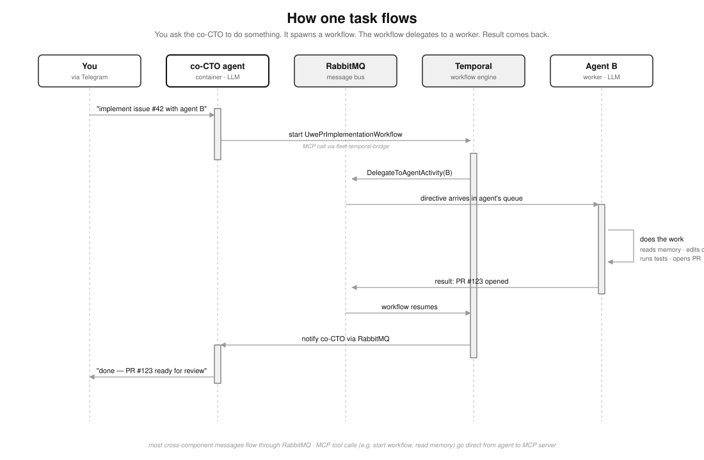
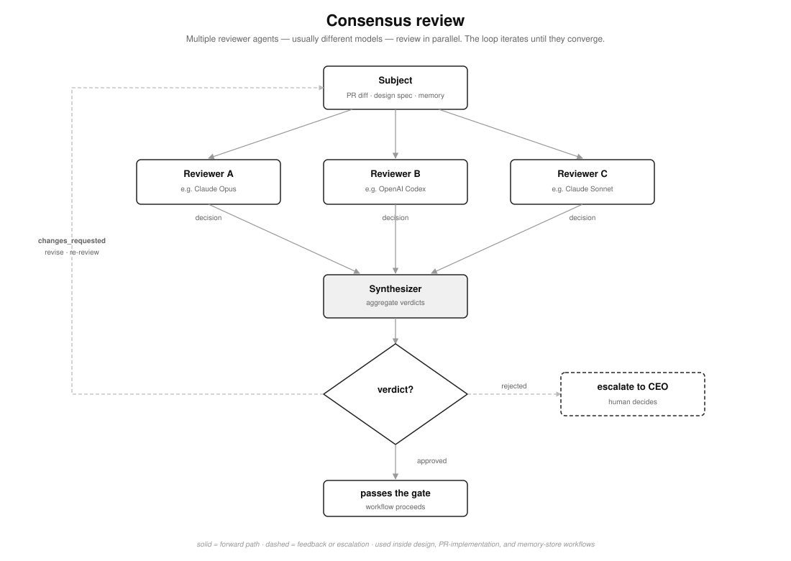
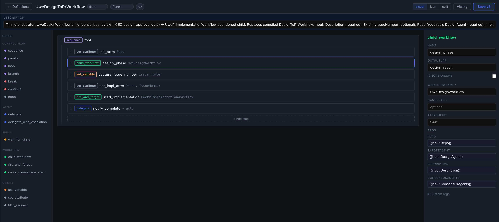

# Architecture

The overview diagram and the five-step summary are in the [README](../README.md#architecture).

## What runs

`setup.sh` provisions the following services, all on the `fleet-net` Docker network:

- `rabbitmq` — message broker
- `fleet-mysql` — agent config + task history
- `qdrant` — vector store for Fleet Memory
- `temporal-postgresql` — Temporal persistence
- `temporal-server` + `temporal-ui` — workflow engine
- `fleet-minio` (+ `fleet-minio-init`) — S3-compatible store for inter-agent file sharing
- `fleet-memory` — semantic memory MCP server
- `fleet-playwright` — browser automation MCP server
- `fleet-orchestrator` — agent registry + lifecycle manager
- `fleet-temporal-bridge` — Temporal workflow runner
- `fleet-bridge` — RabbitMQ relay
- `fleet-dashboard` — web UI at http://localhost:3700

Optional, only with `FLEET_SECRETS_ENABLED=true`: `fleet-secrets` — swaps placeholders for bound
secrets on the way to their hosts, on its own internal `fleet-secrets-net`
([docs/secret-placeholders.md](secret-placeholders.md)).

## How a task flows

  

You DM the co-CTO. It starts a Temporal workflow via `fleet-temporal-bridge`. The workflow publishes a task directive into RabbitMQ; the worker agent picks it up from its queue, does the work (reading memory, editing code, opening a PR), and publishes the result back through RabbitMQ. The workflow resumes, notifies the co-CTO, and you get a Telegram reply with the outcome. Model Context Protocol (MCP) tool calls (start workflow, read memory) go directly from the agent to the MCP server; everything else flows through RabbitMQ.

## Consensus review

  

Used inside the design, PR-implementation, and memory-store workflows. Multiple reviewer agents — usually different models — evaluate the subject in parallel. A synthesizer aggregates their verdicts. `approved` proceeds, `rejected` escalates to the human, and `changes_requested` loops back to the author for revision and re-review.

## Visual Workflow Editor

Workflows can be authored as versioned JSON definitions through the dashboard's visual editor — no code, no redeploy. Control-flow primitives (`sequence`, `parallel`, `loop`, `branch`), agent delegation, child-workflow spawning, and signal-waiting compose into Temporal workflows that run on the same engine as compiled ones.

  
   
  <em>Editing a workflow definition — steps, arguments, and live JSON/visual/split views.</em>

