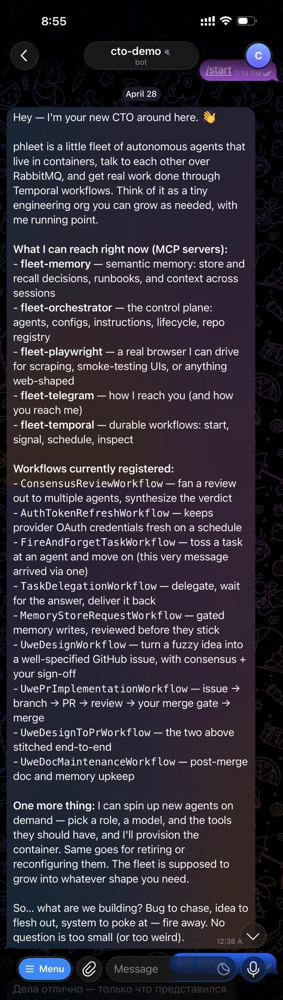

# Setup in detail

The short version is in the [README](../README.md#quickstart). This page is the full walk-through.

## 1. Prerequisites

- **Docker + Docker Compose** (Docker 24+ recommended)
- **~8 GB RAM and ~20 GB free disk** for the full stack (MySQL, Qdrant, Temporal Postgres, MinIO, agent containers)
- **Two Telegram bots** created via [@BotFather](https://t.me/BotFather):
  - a **CTO bot** — dedicated to the co-CTO agent's DMs with you (`TELEGRAM_CTO_BOT_TOKEN`)
  - a **notifier bot** — shared by every other agent for DMs and group-chat relay (`TELEGRAM_NOTIFIER_BOT_TOKEN`)

  A single token works if you only ever run the co-CTO, but once a second agent exists you need the split — Telegram allows only one long-poller per token (see [Troubleshooting](troubleshooting.md)).
- **A Telegram group** (optional) for observing agent activity. Create a group, add both bots as members, then forward any message from the group to [@userinfobot](https://t.me/userinfobot) — it replies with the group's negative integer ID. Paste it into `.env` as `FLEET_GROUP_CHAT_ID`. Leaving it blank disables group routing.
- **A GitHub App** with repo access ([create one](https://github.com/settings/apps)). You'll need its App ID and a downloaded private key (`.pem` file) — `setup.sh` asks for the path, base64-encodes the key, and stores it as `GITHUB_APP_PEM` in `./fleet/.env`. Containers decode it to `/tmp/github-app-key.pem` at runtime; there's no persistent key file on the host outside `.env`.

## 2. Run the setup wizard

```bash
git clone https://github.com/anurmatov/phleet.git
cd phleet
./setup.sh
```

`setup.sh` prompts for the tokens and GitHub App details as it runs — keep this page open while it asks. It creates a `./fleet/` subdirectory next to the repo and puts all runtime state there: `.env`, `seed.json`, generated `docker-compose.yml`, `workspaces/`, `memories/`, credentials, MinIO, and MySQL backups. The whole dir is gitignored — to fully reset, stop containers and `rm -rf fleet/`.

## 3. Open the dashboard

Once setup finishes, the dashboard is live at:

**👉 http://localhost:3700**

Sign-in is controlled by `ORCHESTRATOR_AUTH_TOKEN` in `./fleet/.env` — `setup.sh` generates it for
you. The dashboard asks for it once per browser and then keeps a session; the token is never built
into the page. Internal services calling the orchestrator directly need it as a bearer for writes, as
before. To check a token without changing anything, `GET /api/operator-token` with the bearer answers
`{"status":"accepted"}` or `401` (`"not_required"` when no token is configured). See
[`docs/sign-in.md`](sign-in.md).
To connect the [iOS app](https://github.com/anurmatov/phleet-ios) to this dashboard, open
**Credentials → Devices → Connect a phone** and scan the setup code; see
[`docs/phone-setup-code.md`](phone-setup-code.md).

## 4. Create your co-CTO agent

`seed.example.json` ships with **no agents**. Your first agent — the co-CTO — is created interactively via the dashboard's SetupBanner. Click the **CTO template card** and follow the prompts. Once provisioning completes, you should receive a welcome DM from the CTO bot. **If you don't, send `/start` to your CTO bot first** — Telegram requires the user to initiate the conversation before a bot can DM them.

<p align="center">
  
  <br>
  <em>The co-CTO introduces itself with available tools, workflows, and what it can do.</em>
</p>

Once the co-CTO is up, DM it in Telegram and ask it to grow the rest of the fleet for you.

## Start/stop the stack later

`setup.sh` starts the services for you. To start/stop them later:

```bash
cd fleet
docker compose up -d
docker compose down
```

All stateful services bind-mount their data under `./fleet/` — no named Docker volumes. Back up or wipe the whole installation by archiving or removing that single directory.

## Upgrade after pulling new code

```bash
./upgrade.sh              # rebuild all images + restart
./upgrade.sh --no-cache   # force clean rebuild (no Docker layer cache)
```

`upgrade.sh` skips all prompts — it stops services, regenerates `docker-compose.yml`, rebuilds every image, and restarts. Use it after `git pull` instead of re-running the full `setup.sh`.

Before upgrading an existing installation, check the [upgrade notes](upgrading/README.md).
